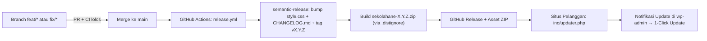

# Architecture — Deployment, Versioning, & Auto-Update

> Mengatur bagaimana perubahan kode di repo ini berubah menjadi rilis versi baru
> dan terdistribusi ke seluruh situs pelanggan secara otomatis. Lihat juga
> [ADR-0002](../decisions/adr-0002-versioning-dan-rilis.md) dan
> [ADR-0003](../decisions/adr-0003-auto-update-github-private.md).

## 1. Alur End-to-End

## 2. CI Validation (`.github/workflows/ci.yml`)
Setiap push ke branch apa pun dan setiap Pull Request ke `main` menjalankan:
1. `composer install`
2. `composer lint:syntax` — cek sintaks seluruh file PHP
3. `composer lint:changed` — cek WordPress Coding Standards pada file yang diubah terhadap `main`
4. `composer analyse` — cek PHPStan (level 3 + baseline)

PR tidak boleh di-merge jika salah satu langkah gagal.

## 3. Release Otomatis (`.github/workflows/release.yml` + `.releaserc.json`)
Berjalan otomatis setiap ada push/merge ke `main`:
1. **Analisis commit** sejak tag terakhir menggunakan Conventional Commits:
   - `fix(...)` / `perf(...)` → kenaikan **patch** (`3.2.1` → `3.2.2`)
   - `feat(...)` → kenaikan **minor** (`3.2.1` → `3.3.0`)
   - `BREAKING CHANGE:` → kenaikan **major** (`3.2.1` → `4.0.0`)
   - `docs` / `chore` / `refactor` / `style` / `test` → **tidak membuat rilis baru**.
2. **Update file versi:** skrip rilis memperbarui header `Version:` di `style.css` dan menambahkan catatan rilis ke `CHANGELOG.md`, lalu melakukan commit `chore(release): X.Y.Z [skip ci]`.
3. **Build paket distribusi (`sekolahane-X.Y.Z.zip`):**
   - Menyalin isi repo ke folder `dist/sekolahane/` dengan mengecualikan semua entri di `.distignore` (tanpa `docs/`, `vendor/`, `.github/`, `AGENTS.md`, dll).
   - Membungkus folder `sekolahane/` ke dalam file ZIP sehingga ketika diekstrak oleh WordPress, struktur foldernya langsung `wp-content/themes/sekolahane/`.
4. **Publish GitHub Release:** melampirkan `sekolahane-X.Y.Z.zip` sebagai release asset.

> **Fallback tag manual:** Jika sewaktu-waktu tag `vX.Y.Z` dibuat manual, workflow tetap mendukung pembuatan ZIP dan GitHub Release dari tag tersebut.

## 4. Mekanisme Auto-Update di Situs Pelanggan (`inc/updater.php`)

### 4.1 Konfigurasi Konstanta
Di awal `inc/updater.php`:
- `SEKOLAHANE_UPDATER_REPO` = `'webaneid/sekolahane'`
- `SEKOLAHANE_UPDATER_SLUG` = `'sekolahane'`

### 4.2 Urutan Pembacaan Token GitHub
`sekolahane_updater_get_token()` membaca token dengan prioritas:
1. Konstanta `SEKOLAHANE_UPDATER_TOKEN` di `wp-config.php` (direkomendasikan agar token tidak tersimpan di DB dan tidak terlihat di wp-admin).
2. ACF Option `ane_updater_token` di menu **Webane Settings → Update** (kompatibel dengan pola `jalawarta`).

Token menggunakan **GitHub Fine-grained Personal Access Token** dengan permission tunggal: **Contents: Read-only** hanya pada repo `webaneid/sekolahane`.

### 4.3 Siklus Cek & Instalasi
1. **Cache 12 jam:** Data rilis disimpan di transient `sekolahane_github_release` selama 12 jam (atau 1 jam jika respons error agar tidak membanjiri API GitHub).
2. **Hook `pre_set_site_transient_update_themes`:** Membandingkan versi rilis GitHub dengan versi `style.css` saat ini menggunakan `version_compare()`.
3. **Hook `http_request_args`:** Menyisipkan header `Authorization: token ...` dan `Accept: application/octet-stream` **hanya** untuk URL API/asset GitHub milik repo `SEKOLAHANE_UPDATER_REPO`.
4. **Hook `upgrader_source_selection`:** Memastikan nama folder hasil ekstraksi selalu `sekolahane/`.
5. **Tombol "Cek Update Sekarang":** Menggunakan `wp_nonce_url()` + `check_admin_referer( 'sekolahane_force_check' )` dan `current_user_can( 'update_themes' )`.
